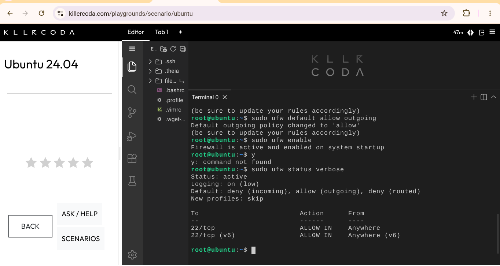
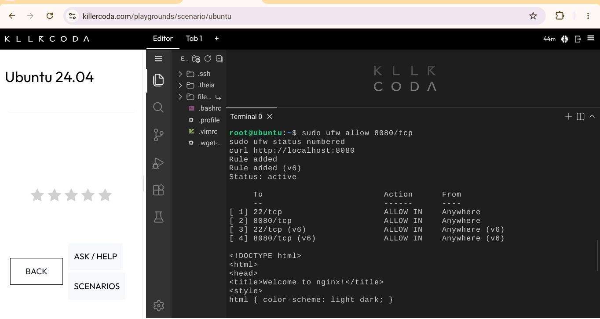

# Firewall Configuration

## 1. Allow SSH (Port 22)
```bash
sudo ufw allow ssh
```

## 2. Set Default Deny Policy
```bash
sudo ufw default deny incoming
sudo ufw default allow outgoing
```

## 3. Allow Port 8080 (Web Application)
```bash
sudo ufw allow 8080/tcp
```

## 4. Activate and Verify
```bash
sudo ufw enable
sudo ufw status verbose
sudo ufw status numbered
```

## What if `ufw enable` runs before `ufw allow ssh`?
The firewall would immediately block all incoming connections, including SSH, locking the administrator out of the server.

## Evidence


