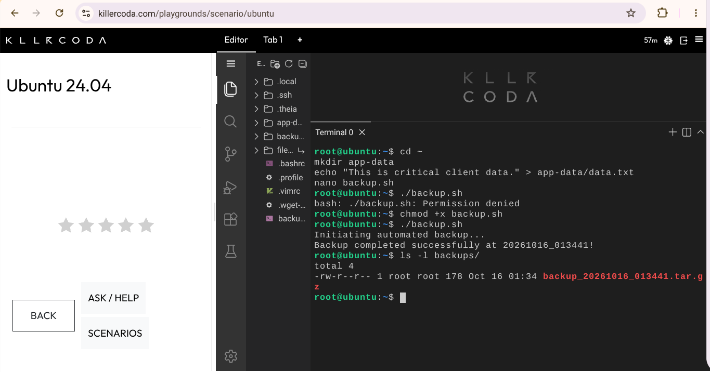
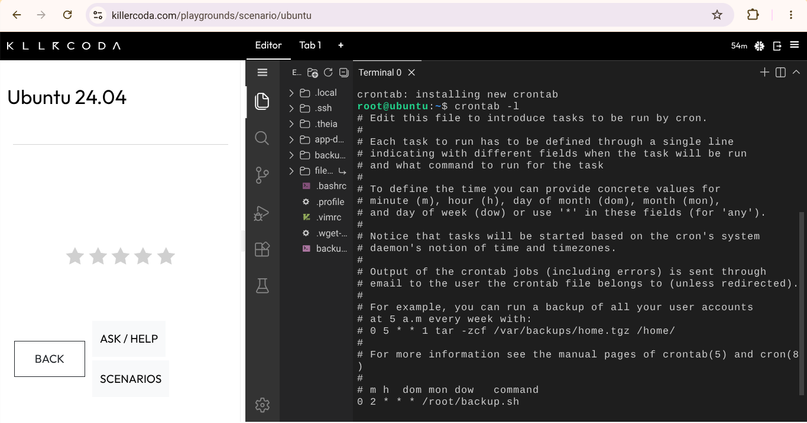

# Backup Script Guide

## 1. The Script (`backup.sh`)
```bash
#!/bin/bash
# Automated Backup Script for CloudNova Technologies

SOURCE_DIR="app-data"
BACKUP_DIR="backups"
TIMESTAMP=$(date +"%Y%m%d_%H%M%S")

echo "Initiating automated backup..."

# Create the backup directory if it does not exist
mkdir -p $BACKUP_DIR

# Compress the source directory into a tarball (.tar.gz)
tar -czf $BACKUP_DIR/backup_$TIMESTAMP.tar.gz $SOURCE_DIR

echo "Backup completed successfully at $TIMESTAMP!"
```

## 2. What `chmod +x` Does
`chmod +x backup.sh` adds the **execute permission** to the file. Without it, Linux treats the file as plain text and refuses to run it ("Permission denied"). With it, the file can be run as a program using `./backup.sh`.

## 3. Cron Expression
```
0 2 * * * /root/backup.sh
```

| Field | Value | Meaning |
|-------|-------|---------|
| Minute | `0` | At minute 0 |
| Hour | `2` | At 2 AM (24-hour clock) |
| Day of Month | `*` | Every day of the month |
| Month | `*` | Every month |
| Day of Week | `*` | Every day of the week |

**Result:** the backup runs every night at 2:00 AM.

## 4. Evidence


